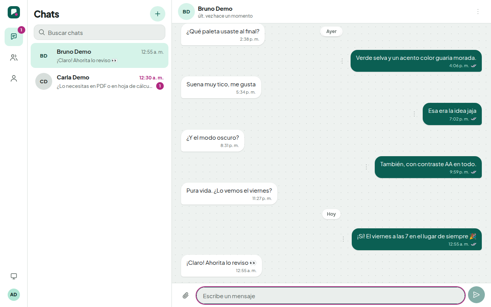
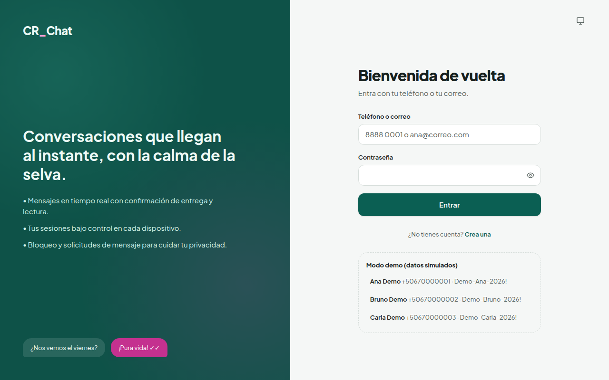
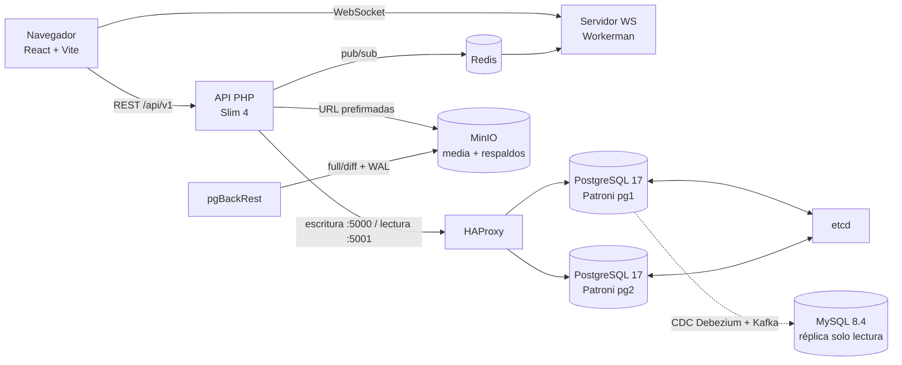

# CR-Chat

Aplicación de mensajería 1:1 en tiempo real, construida como proyecto de portafolio **Backend / Full-Stack** con foco en
tres cosas: **seguridad de la API**, **alta disponibilidad y recuperación de datos**, y **tiempo real**.

Nació como trabajo del curso universitario *Administración de Bases de Datos* y se rediseñó después de una auditoría
de seguridad (ver [Evolución](#evolución-del-proyecto)).



<table>
  <tr>
    <td width="68%"></td>
    <td width="32%"></td>
  </tr>
  <tr>
    <td align="center">Inicio de sesión (modo demo)</td>
    <td align="center">Móvil, modo oscuro</td>
  </tr>
</table>

## Funcionalidades

- Registro e inicio de sesión por **teléfono o email**, sesiones por dispositivo y revocación remota.
- Contactos con alias y búsqueda (sin acentos ni mayúsculas, o por prefijo de teléfono), **bloqueo** y solicitudes
  de mensaje de desconocidos.
- Conversaciones con mensajes **cifrados en la aplicación**, edición (15 min) y borrado, adjuntos por URL prefirmada,
  scroll infinito por cursor.
- **Tiempo real**: entrega instantánea, ✓ entregado / ✓✓ visto, «escribiendo…» y presencia.
- Interfaz responsive (dos paneles en escritorio), modo oscuro y accesible (ARIA, teclado, contraste AA).

## Arquitectura



| Capa | Carpeta | Tecnología |
|---|---|---|
| Frontend | [`presentacion/`](presentacion/) | React 19, Vite, TypeScript estricto, TanStack Query, Zustand, Tailwind (tema propio), cliente generado desde OpenAPI |
| API REST | [`datos/`](datos/) | PHP 8.4, Slim 4, PHP-DI, JWT, argon2id, libsodium, rate limiting en Redis |
| Tiempo real | [`datos/ws/`](datos/ws/) | Workerman; la API publica eventos en Redis tras cada `COMMIT` |
| Datos | [`Postgres/`](Postgres/), [`infra/`](infra/) | PostgreSQL 17 en HA (Patroni + etcd + HAProxy), migraciones dbmate, pgBackRest → MinIO |
| Réplica analítica | [`MysqlB/`](MysqlB/) | MySQL 8.4 de solo lectura alimentado por CDC (Debezium + Kafka KRaft) |

Los contratos entre capas son la fuente de verdad: [`openapi.yaml`](docs/contratos/openapi.yaml) (REST),
[`ws-eventos.md`](docs/contratos/ws-eventos.md) (WebSocket) y [`db-funciones.md`](docs/contratos/db-funciones.md)
(funciones de BD).

## Seguridad

- **IDOR**: ids públicos UUID; cada función de BD recibe el id del usuario autenticado y valida la propiedad.
  Un recurso ajeno responde **404**, igual que uno inexistente.
- **Credenciales**: contraseñas con argon2id en PHP; la base solo guarda el hash. Login en tiempo constante y
  respuestas uniformes para no permitir enumerar cuentas.
- **Tokens**: access JWT de 15 min sin datos personales; refresh opaco con rotación y **detección de reutilización**
  (revoca la sesión). Comprobación de sesión activa en cada petición.
- **Mensajes cifrados** con XChaCha20-Poly1305 (libsodium) en la API; la clave nunca llega a la base de datos.
- **Rate limiting** por política (login, registro, envío, subidas…) con `RateLimit` y `Retry-After`.
- Errores RFC 9457 sin trazas, CORS con lista blanca, roles de BD con mínimo privilegio (la app nunca es superusuario).

Detalle de requisitos y de cada hallazgo de la auditoría con su mitigación:
[`docs/requerimientos-api.md`](docs/requerimientos-api.md).

## Disponibilidad y recuperación (medido)

| Escenario | Resultado |
|---|---|
| Cae el líder de PostgreSQL | La réplica se promueve y HAProxy redirige: escrituras de nuevo en **4–8 s** |
| El nodo caído vuelve | Se reincorpora como réplica (pg_rewind) en **2–5 s** |
| Error lógico: restauración a un instante (PITR) | Clúster completo con escritura en **24 s** (55 s en total) |
| Pérdida de ambos nodos | Se pierden como máximo **60 s** de WAL |

Respaldos full semanales y diferenciales diarios **cifrados**, archivado continuo de WAL y ventana de PITR de 7 a 14 días.
Runbook completo: [`docs/db/recuperacion.md`](docs/db/recuperacion.md).

## Puesta en marcha

Requisitos: Docker con Compose. El núcleo de datos consume ≈ 0,4 GiB de RAM; el profile `cdc`, ≈ 1 GiB más.

```bash
cp .env.example .env                                  # completa los secretos (valores propios)
docker compose up -d --wait haproxy backup            # PostgreSQL en HA, migraciones, credenciales y respaldos
docker compose --profile demo up db-seed              # usuarios de demo (opcional)
VITE_USE_MOCKS=false docker compose up -d web-datos ws web
```

| Servicio | URL |
|---|---|
| Aplicación | http://localhost:5173 |
| API REST | http://localhost:8000/api/v1 |
| Documentación (Swagger UI) | http://localhost:8000/docs |
| WebSocket | ws://localhost:8080/ws |

**Solo el frontend, sin backend:** `docker compose up web` arranca en modo demo (`VITE_USE_MOCKS=true`), con la API
y el WebSocket simulados con MSW y un interlocutor que responde.

**Réplica MySQL (opcional):**
`docker compose --profile cdc up -d --wait mysql kafka connect && docker compose --profile cdc up cdc-init`.

### Usuarios de demo

Solo para desarrollo:

| Usuario | Teléfono | Email | Contraseña |
|---|---|---|---|
| Ana Demo | `+50670000001` | `ana@demo.crchat.local` | `Demo-Ana-2026!` |
| Bruno Demo | `+50670000002` | `bruno@demo.crchat.local` | `Demo-Bruno-2026!` |
| Carla Demo | `+50670000003` | `carla@demo.crchat.local` | `Demo-Carla-2026!` |

Entra como Carla para ver una solicitud de mensaje.

## Pruebas

| Capa | Comando | Cobertura |
|---|---|---|
| API y WebSocket | `bash datos/tests/entorno-pruebas.sh up && bash datos/tests/entorno-pruebas.sh test` | PHPUnit (41), pruebas de API (185, incluidos casos IDOR) y de WebSocket (34) en un entorno aislado |
| Frontend | `docker compose run --rm web npm test` (también `lint` y `build`) | Vitest + Testing Library + MSW (48) |
| Base de datos | ver [`docs/db/README.md`](docs/db/README.md#pruebas) | 213 casos de funciones y permisos, más chequeos del catálogo |
| Operación | `infra/scripts/probar-failover.sh`, `infra/scripts/probar-restauracion.sh` | Failover automático y PITR |

## Evolución del proyecto

La primera versión fue el trabajo del curso *Administración de Bases de Datos*: el mismo esquema en **MySQL y
PostgreSQL**, la lógica en procedimientos almacenados, triggers de auditoría, respaldos con `cron` y una API PHP
que hacía **failover entre los dos motores**.

Una auditoría de esa versión encontró, entre otros, robo de cuenta en el login, IDOR por ids secuenciales,
contraseñas cifradas de forma reversible y que el failover entre motores reasignaba ids (un token podía acabar
apuntando a otro usuario). El rediseño mantiene los temas del curso, pero los resuelve con prácticas de producción:

| Tema | Versión del curso | Versión actual |
|---|---|---|
| Redundancia | Failover de la API entre MySQL y PostgreSQL | PostgreSQL en HA con Patroni; MySQL como réplica de solo lectura por CDC |
| Respaldos | `pg_dump` / `mysqldump` con `cron` | pgBackRest cifrado en MinIO con PITR probado y medido |
| Modelo | Chats duplicados por participante | Esquema en 3FN, UUID públicos, recibos por participante |
| Seguridad | Cifrado reversible en SQL | argon2id, cifrado de mensajes en la app, roles de mínimo privilegio |
| Frontend | Esqueleto de Angular | React con tiempo real completo |

El desarrollo se organizó por fases (contratos → implementación) con agentes de IA especializados por capa
(backend, DBA, frontend) y un revisor; las reglas están en [`AGENTS.md`](AGENTS.md).

## Documentación

- [Requisitos de la API y auditoría](docs/requerimientos-api.md)
- [Contratos: REST](docs/contratos/openapi.yaml) · [WebSocket](docs/contratos/ws-eventos.md) · [Funciones de BD](docs/contratos/db-funciones.md)
- Base de datos: [modelo](docs/db/modelo.md) · [infraestructura](docs/db/infraestructura.md) · [recuperación](docs/db/recuperacion.md) · [optimización](docs/db/optimizacion.md)
- [Frontend](presentacion/README.md)
