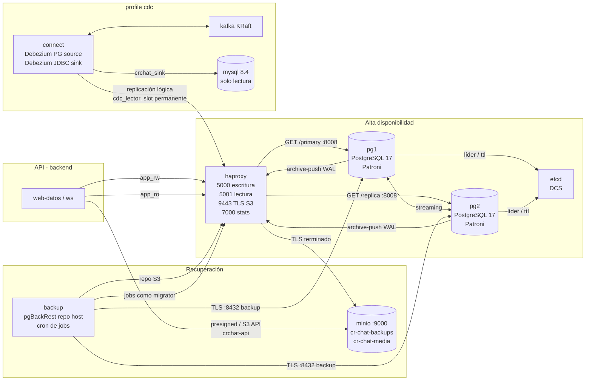

# Infraestructura de datos de CR_Chat

Plataforma de datos tratada como un servicio gestionado: alta disponibilidad (Patroni), punto único de
conexión (HAProxy), respaldos continuos con PITR (pgBackRest + MinIO), mantenimiento programado y CDC hacia
una réplica MySQL de solo lectura. Todo está en `docker-compose.yml` (servicios de datos) e `infra/`.
Recuperación y RPO/RTO: [`recuperacion.md`](recuperacion.md).

## Diagrama



## Servicios

| Servicio | Imagen | Rol | Límite RAM | Puerto publicado (solo 127.0.0.1) |
|---|---|---|---|---|
| `certs` | `crchat/backup:17` (build) | Una vez: CA interna y certificados TLS (volumen `certs`) | 64 MiB | — |
| `etcd` | `quay.io/coreos/etcd:v3.5.21` | DCS de Patroni (1 nodo) | 128 MiB | — |
| `pg1`, `pg2` | `crchat/patroni:17` (build `infra/patroni/Dockerfile`, target `patroni`) | PostgreSQL 17 + Patroni 4.1 + servidor TLS de pgBackRest 2.60 | 640 MiB c/u | — |
| `haproxy` | `haproxy:3.2-alpine` | Enrutamiento por rol (API REST de Patroni) y TLS hacia MinIO | 64 MiB | `5000`, `5001`, `7000` |
| `minio` | `cgr.dev/chainguard/minio@sha256:…` | Almacén S3 (respaldos y archivos de la API) | 384 MiB | `9000` (API S3), `9001` (consola) |
| `minio-init` | misma de MinIO (trae `mc`) | Una vez: buckets, políticas, usuarios, ciclo de vida | 128 MiB | — |
| `dbmate` | `ghcr.io/amacneil/dbmate:2` | Una vez: migraciones contra `haproxy:5000` | 64 MiB | — |
| `db-init` | `crchat/patroni:17` | Una vez: `asignar-credenciales.sql` (LOGIN, contraseñas, `REVOKE CONNECT`) | 64 MiB | — |
| `db-seed` (profile `demo`) | `crchat/patroni:17` | Una vez: `Postgres/seed/demo.sql` como `app_rw` | 64 MiB | — |
| `backup` | `crchat/backup:17` (target `backup`) | Repo host de pgBackRest + cron (respaldos y mantenimiento) | 256 MiB | — |
| `mysql` (cdc) | `mysql:8.4` | Réplica de solo lectura | 512 MiB | `3306` |
| `kafka` (cdc) | `apache/kafka:4.1.0` | Broker + controller KRaft (1 nodo) | 768 MiB | — |
| `connect` (cdc) | `quay.io/debezium/connect:3.3` | Kafka Connect con Debezium Postgres y JDBC sink | 1 GiB | `8083` (REST) |
| `cdc-init` (cdc) | `crchat/patroni:17` | Una vez: slot permanente en Patroni + registro de conectores | 64 MiB | — |

Notas:
- Los servicios permanentes tienen `restart: unless-stopped` y healthcheck. Los de una sola vez usan
  `restart: on-failure:3` (con `unless-stopped` se reiniciarían en bucle al terminar bien).
- Sin `container_name`: los nombres los pone el proyecto de compose (no chocan con los contenedores antiguos).
- **MinIO**: MinIO Inc. dejó de publicar imágenes oficiales en Docker Hub/Quay en 2025. Se usa la imagen de
  Chainguard (proveedor reconocido, reconstruida a diario) **fijada por digest**. Para actualizar: `docker pull
  cgr.dev/chainguard/minio:latest`, probar y cambiar el digest en el compose (dos lugares).
- Volúmenes con nombre (en `/var/lib/docker`, no en el disco del proyecto): `certs`, `etcd_data`, `pg1_data`,
  `pg2_data`, `minio_data`, `mysql_data`, `kafka_data`.

## Puertos y endpoints

| Endpoint (red interna) | Qué es | Quién lo usa |
|---|---|---|
| `haproxy:5000` | Líder de Patroni (escritura). HAProxy sondea `GET /primary` cada 1 s; un ex líder sale en ~2 s y sus conexiones se cortan (`shutdown-sessions`). | API (`app_rw`), dbmate, db-init, jobs (`migrator`), Debezium (`cdc_lector`) |
| `haproxy:5001` | Réplicas con `GET /replica?lag=10MB`; si no queda ninguna, cae al líder. | API (`app_ro`) |
| `haproxy:9443` | TLS (CA interna) → `minio:9000`. pgBackRest solo habla HTTPS con S3. | pg1, pg2, backup |
| `haproxy:7000` | Estadísticas (`http://127.0.0.1:7000/`) | Operador |
| `haproxy:8404/salud` | 200 solo si hay líder (healthcheck) | Docker |
| `minio:9000` | API S3 en HTTP plano (red interna y `127.0.0.1:9000` para URLs prefirmadas del navegador) | API (`crchat-api`) |
| `pgN:8008` | API REST de Patroni (GET abiertos, PATCH/POST con usuario/clave) | HAProxy, cdc-init, operador |
| `pgN:8432` | Servidor TLS de pgBackRest (solo acepta el certificado cliente `CN=backup`) | backup |
| `connect:8083` | REST de Kafka Connect | cdc-init, operador |

## Flujos

1. **Escritura**: API → `haproxy:5000` → líder. Al caer el líder, Patroni (ttl 20 s, loop 5 s) promueve la
   réplica; con `docker stop` el líder libera la llave al apagarse y la promoción es inmediata. Medido: escrituras
   de nuevo en **4,3 s, 7,6 s y 4,6 s** (tres pruebas; las dos últimas con CDC activo).
2. **Lectura**: API → `haproxy:5001` → réplica en streaming (asíncrona; lag máximo servido 10 MiB). Una lectura
   inmediatamente posterior a una escritura propia debe ir por 5000 (lectura de lo propio).
3. **WAL → MinIO**: `archive_command = pgbackrest archive-push` (asíncrono, zstd, cifrado aes-256-cbc) →
   `haproxy:9443` → bucket `cr-chat-backups/pgbackrest`. `archive_timeout = 60s`.
4. **Respaldos**: el contenedor `backup` (fuera de los nodos) ejecuta `pgbackrest backup` por TLS contra el nodo
   que sea líder (pgBackRest lo detecta). Detalles y calendario: [`recuperacion.md`](recuperacion.md).
5. **Mantenimiento** (cron de `backup`, como `migrator` por `haproxy:5000`): `fn_purgar_sesiones()` diario y
   `fn_crear_particiones_auditoria(3)` mensual.
6. **CDC**: `cdc_lector` (REPLICATION, sin superusuario) lee la publicación `crchat_cdc` (migración 004) con el
   slot `debezium_crchat` → tópicos `crchat.public.<tabla>` → JDBC sink (upsert por PK, borra con tombstones) →
   MySQL `crchat.<tabla>`. Medido: un INSERT en PG aparece en MySQL en **0,9 s**.

## Patroni

- Configuración común: `infra/patroni/patroni.yml`; lo que cambia por nodo y los secretos llegan por variables
  `PATRONI_*` (compose). Los parámetros de Postgres viven en la DCS (iguales en ambos nodos); cambiarlos con
  `docker compose exec pg1 patronictl -c /etc/patroni/patroni.yml edit-config`.
- `use_pg_rewind` + `data-checksums` + `wal_log_hints`: el ex líder vuelve como réplica sin reclonarse
  (medido: 2,5 s a 4,8 s).
- `failsafe_mode: true`: con etcd de 1 nodo caído, el líder sigue aceptando escrituras mientras vea a todos los
  miembros por REST (sin esto se degradaría a solo lectura).
- `maximum_lag_on_failover: 1 MiB`: no se promueve una réplica muy atrasada.
- `shared_preload_libraries = pg_stat_statements,auto_explain` (`auto_explain.log_min_duration = 500ms`,
  `log_min_duration_statement = 1s`).
- `max_slot_wal_keep_size = 2GB`: un slot sin consumidor (CDC detenido) se invalida antes de llenar el disco.
- `pg_hba`: `peer` local para `postgres`; `scram-sha-256` solo desde `samenet` (la red de Docker); todo lo demás
  `reject`. Además `REVOKE CONNECT ON DATABASE cr_chat, postgres FROM PUBLIC` (db-init) y `CONNECT` explícito
  para `migrator`, `app_rw`, `app_ro`, `cdc_lector`.

Comandos útiles:

```bash
docker compose exec pg1 patronictl -c /etc/patroni/patroni.yml list
docker compose exec pg1 patronictl -c /etc/patroni/patroni.yml switchover --leader pg1 --candidate pg2 --force
infra/scripts/probar-failover.sh            # mide failover y reincorporación (no usar con tráfico real)
```

## MinIO

| Bucket | Contenido | Usuario (política) | Acceso anónimo |
|---|---|---|---|
| `cr-chat-backups` | `pgbackrest/` (repo cifrado) y `globals/` (expira a los 30 días) | `MINIO_BACKUP_ACCESS_KEY` (`cr-chat-backups-rw`) | no |
| `cr-chat-media` | Avatares y adjuntos de la API | `MINIO_API_ACCESS_KEY` (`cr-chat-media-rw`) | no (URLs prefirmadas) |

Comprobado: el usuario de la API no puede listar `cr-chat-backups` (`Access Denied`) y el de respaldos no puede
escribir en `cr-chat-media`. El usuario root solo lo usa `minio-init`. CORS para el navegador:
`MINIO_CORS_ORIGIN` (por defecto `http://localhost:5173`).

## CDC hacia MySQL (profile `cdc`)

- **Publicación** `crchat_cdc` (migración `004_publicacion_cdc.sql`, dueño `migrator`): `usuario` (lista de
  columnas **sin `pass_hash`**), `media`, `contacto`, `bloqueo`, `conversacion`, `participante`, `mensaje`,
  `recibo_mensaje`. No salen `sesion`, `sesion_refresh` ni `auditoria`. `mensaje.contenido`/`nonce` se replican
  como bytes tal cual (`binary.handling.mode=bytes`; comprobado con SHA-256 en ambos lados).
- **Slot y failover**: `cdc-init` registra `debezium_crchat` como **slot permanente de Patroni**
  (`PATCH /config` → `slots`). Patroni lo crea en el líder y lo mantiene copiado y avanzado en la réplica
  (`hot_standby_feedback=on`). Probado: con CDC activo se detuvo el líder; el conector se reconectó solo por
  `haproxy:5000` al nuevo líder y un INSERT posterior llegó a MySQL en 1,5 s. Entrega *al menos una vez*: tras
  un failover pueden repetirse eventos desde el último LSN confirmado; el sink hace upsert por PK, así que es
  idempotente.
- **Esquema destino**: `MysqlB/init/02-esquema.sql` (lo crea el entrypoint de MySQL al inicializar el volumen).
  Sin FK ni UNIQUE de negocio (el sink aplica cada tabla por separado), `public_id` UNIQUE, índices de lectura,
  `DATETIME(6)` en UTC, `MEDIUMBLOB` para el contenido cifrado. El sink tiene `schema.evolution=none`: una
  columna nueva publicada exige actualizar este archivo (y `ALTER TABLE` en la réplica existente).
- **Usuarios MySQL**: `crchat_sink` (DDL/DML solo en `crchat`, lo usa Connect) y `crchat_lectura` (solo
  `SELECT`; comprobado: `INSERT`/`UPDATE`/`CREATE` → `ERROR 1142`). MySQL ya no tiene procedimientos ni es
  fallback de escritura.
- **Secretos**: los JSON de `infra/cdc/` usan `${env:DB_CDC_PASSWORD}` y `${env:MYSQL_SINK_PASSWORD}`
  (`EnvVarConfigProvider` de Kafka Connect); la REST de Connect nunca devuelve la contraseña.
- **Apagar CDC**: `infra/cdc/desactivar.sh` (borra conectores, quita el slot de la DCS y del líder y detiene el
  profile). Detener solo los contenedores deja el slot reteniendo WAL hasta `max_slot_wal_keep_size` (2 GB), y
  después el slot se invalida y hay que re-sembrar MySQL (`snapshot.mode=initial` con un slot nuevo).
- **Re-sembrar la réplica**: borrar los conectores, `DROP DATABASE crchat` + `02-esquema.sql`, resetear el
  grupo `connect-crchat-mysql-sink` a `--to-earliest` (los tópicos son compactados y conservan el último estado
  por PK) y volver a ejecutar `cdc-init`.

## Arranque

```bash
cp .env.example .env    # y completar los secretos
docker compose up -d --wait haproxy backup        # núcleo: certs, etcd, pg1, pg2, haproxy, minio(+init), dbmate, db-init, backup
docker compose --profile demo up db-seed          # opcional: usuarios de demo
docker compose --profile cdc up -d --wait mysql kafka connect && docker compose --profile cdc up cdc-init
```

`haproxy` solo reporta *healthy* cuando hay líder, así que `dbmate` (que depende de él) espera al clúster. Las
migraciones van como superusuario (la 001 crea roles y extensiones); la 002-004 hacen `SET LOCAL ROLE migrator`.

## Consumo observado (`docker stats --no-stream`, todo arriba con CDC, en reposo tras las pruebas)

| Contenedor | RAM | Límite |
|---|---|---|
| pg1 / pg2 | 85 / 61 MiB | 640 MiB |
| etcd | 25 MiB | 128 MiB |
| haproxy | 20 MiB | 64 MiB |
| minio | 201 MiB | 384 MiB |
| backup | 3 MiB (sube durante un respaldo) | 256 MiB |
| **Núcleo** | **≈ 0,4 GiB** | 2,1 GiB |
| connect | 501 MiB | 1 GiB |
| kafka | 345 MiB | 768 MiB |
| mysql | 145 MiB | 512 MiB |
| **Profile cdc** | **≈ 1,0 GiB** | 2,3 GiB |

Disco: imágenes propias `crchat/patroni:17` y `crchat/backup:17` ≈ 700 MB cada una (comparten capas con
`postgres:17-bookworm`); `quay.io/debezium/connect:3.3` 2,2 GB, `mysql:8.4` 1,1 GB, `apache/kafka:4.1.0` 0,7 GB.
Todo en `/var/lib/docker`. Arranque desde cero: núcleo en ≈ 33 s, CDC en ≈ 80-100 s más.

## Integración con la aplicación

- `web-datos` y `ws` (bloques del backend) dependen de `haproxy` (healthy = hay líder), `db-init` (credenciales
  aplicadas), `minio` y `minio-init` (bucket y usuario creados), además de `redis`.
- Se retiró `container_name: servidor-datos` de `web-datos`: chocaba con el contenedor detenido del esquema
  anterior (`servidor-datos`). El nombre lo pone compose (`<proyecto>-web-datos-1`).
- `datos/.env` (backend) debe usar las mismas credenciales que el `.env` raíz: `DB_RW_PASSWORD` =
  `DB_APP_RW_PASSWORD`, `DB_RO_PASSWORD` = `DB_APP_RO_PASSWORD`, `MINIO_ACCESS_KEY`/`MINIO_SECRET_KEY` =
  `MINIO_API_ACCESS_KEY`/`MINIO_API_SECRET_KEY`, `MINIO_BUCKET=cr-chat-media`.
- CORS de MinIO: `MINIO_CORS_ORIGIN` (por defecto `http://localhost:5173`). Comprobado con un preflight
  `OPTIONS` (PUT + `Content-Type`): 204 con `Access-Control-Allow-Origin: http://localhost:5173`; otro origen no
  recibe cabeceras CORS.
