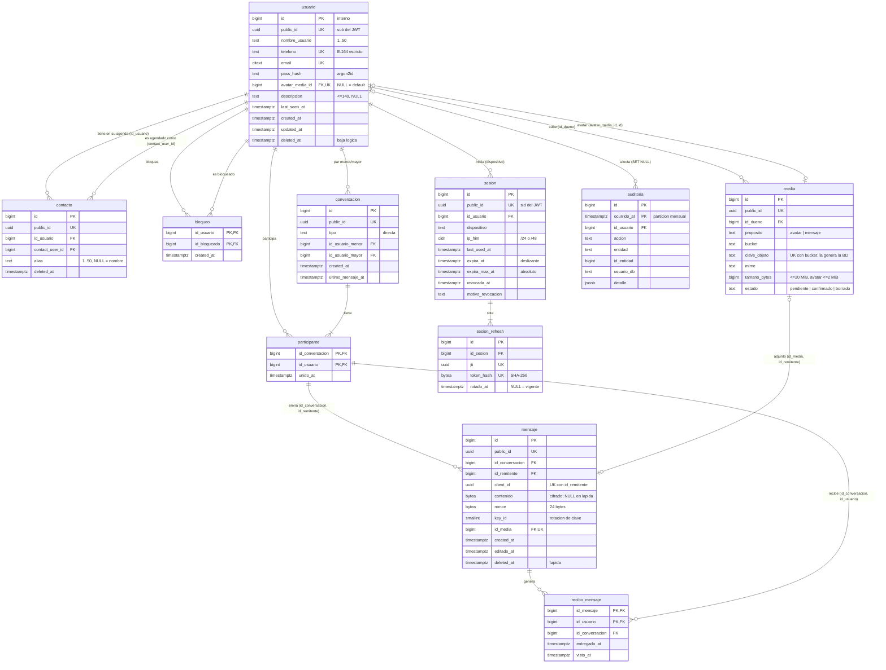

# Modelo de datos de CR_Chat (PostgreSQL 17)

Fuente: `Postgres/migraciones/002_esquema.sql` + `004_esquema_api_v1.sql`. Contrato de funciones:
[`docs/contratos/db-funciones.md`](../contratos/db-funciones.md).



## Ids públicos

Cada recurso que la API expone (`usuario`, `contacto`, `conversacion`, `mensaje`, `sesion`, `media`) tiene
`public_id uuid NOT NULL UNIQUE DEFAULT gen_random_uuid()`. Los `bigint` siguen siendo la PK, el destino de
todas las FK y la columna de los índices (más compactos y con mejor localidad que un uuid v4), pero **ninguna
función de la API los recibe ni los devuelve**. Así se elimina la enumeración de ids secuenciales (IDOR del
esquema anterior) sin pagar uuid en cada FK. Los cursores usan `public_id` como desempate o, en mensajes,
el `public_id` del mensaje (la función obtiene su `(created_at, id)` interno validando la conversación).

## Qué cambió respecto al esquema anterior y por qué

| Problema anterior | Solución |
|---|---|
| **Dos filas de `chat` por conversación** (una por sentido). | `conversacion` una fila por conversación y `participante` como N:M. |
| **Conversaciones duplicadas posibles.** | `UNIQUE (id_usuario_menor, id_usuario_mayor)` con `CHECK (menor < mayor)`; `INSERT … ON CONFLICT DO NOTHING` como obtener-o-crear. |
| **`contact` unido a `usr` por texto** (`contact_number`). | `contacto.contact_user_id` FK a `usuario` (3FN: el teléfono vive solo en `usuario`). |
| **Contactos duplicados.** | `UNIQUE (id_usuario, contact_user_id)` y `CHECK (id_usuario <> contact_user_id)`. |
| **El contacto era obligatorio para chatear** (se creaba un "Unknown"). | La conversación no depende del contacto; `es_contacto=false` marca una solicitud de mensaje. |
| **`delivered` / `seen` booleanos en el mensaje.** | `recibo_mensaje` por destinatario con marcas de tiempo; marcador monótono `fn_marcar_recibos`. |
| **Contraseña y email cifrados de forma reversible.** | `pass_hash` argon2id verificado en PHP; `email citext UNIQUE` en claro. |
| **Ids secuenciales expuestos** (IDOR en `/usr/profile/{id}`). | `public_id uuid` en todos los recursos; funciones solo con uuid; perfil público con relación y sin bloqueo. |
| **URLs libres** en `profile_picture` / `content_media` (`javascript:`). | Tabla `media` (MinIO) con FK desde `usuario.avatar_media_id` y `mensaje.id_media`; la clave del objeto la genera la BD. |
| **Refresh token único por usuario.** | `sesion` por dispositivo (`sid` estable) + `sesion_refresh` (solo hash SHA-256, cadena de rotación, reutilización = revocación). |
| **Contenido cifrado con AES en SQL** y la clave como parámetro. | `contenido` + `nonce` (24 bytes) + `key_id` cifrados en PHP con libsodium; la BD nunca ve la clave. |
| **Reenvíos duplicaban mensajes.** | `UNIQUE (id_remitente, client_id)` y envío idempotente. |
| **Logs con `ON DELETE CASCADE`.** | `auditoria` con `ON DELETE SET NULL`, particionada por mes. |
| **Sin índices en FK en PG.** | Toda FK tiene un índice que la cubre (`Postgres/pruebas/catalogo.sql`). |

## Normalización

- **1FN:** atributos atómicos; no hay listas en columnas ni el par "chat de ida y de vuelta".
- **2FN:** en las PK compuestas (`participante`, `bloqueo`, `recibo_mensaje`) los atributos dependen de la clave completa.
- **3FN:** teléfono, nombre y avatar del contacto se leen de `usuario`; `alias` sí es atributo del contacto.
  Los metadatos del archivo (`mime`, `tamano_bytes`, `bucket`, `clave_objeto`) viven en `media`, no en el
  mensaje ni en el usuario. Los refresh tokens dependen de la sesión, no del usuario (`sesion_refresh`).

### Redundancias deliberadas (controladas)

1. **`conversacion.id_usuario_menor / id_usuario_mayor`** (derivables de `participante`): clave natural para
   el `UNIQUE` del par. Solo `fn_crear_conversacion` las escribe, junto con los participantes.
2. **`recibo_mensaje.id_conversacion`** (derivable de `mensaje`): amarrada por dos FK compuestas (al mensaje y
   al participante). Hace que no leídos y marcar recibos cuesten O(pendientes) (ver `optimizacion.md`).
3. **`conversacion.ultimo_mensaje_at`** (derivable de `max(mensaje.created_at)`): ordena el listado sin
   agregar. La actualiza `fn_enviar_mensaje` con `greatest(...)` (nunca retrocede).

## Integridad referencial y `ON DELETE`

| FK | Acción | Motivo |
|---|---|---|
| `contacto.*`, `bloqueo.*`, `sesion.id_usuario`, `participante.*`, `conversacion.id_usuario_*`, `media.id_dueno` → `usuario` | CASCADE | El borrado **físico** es administrativo (derecho al olvido). Lo normal es la baja lógica. Los objetos de MinIO de un usuario purgado los limpia el job de huérfanos. |
| `mensaje (id_conversacion, id_remitente)` → `participante` | CASCADE | El remitente debe ser participante. |
| `recibo_mensaje` → `mensaje` y → `participante` | CASCADE | Un recibo no existe sin su mensaje y su destinatario. |
| `usuario (avatar_media_id, id)` → `media (id, id_dueno)` | SET NULL (`avatar_media_id`) | El avatar debe ser media **del propio usuario** (FK compuesta). Si la media se purga, el usuario vuelve al avatar por defecto (PG15+: SET NULL con lista de columnas, no anula `id`). |
| `mensaje (id_media, id_remitente)` → `media (id, id_dueno)` | **NO ACTION** | El adjunto debe ser media **del remitente**. La purga nunca puede dejar un mensaje sin su adjunto: la lápida desreferencia antes (`id_media = NULL`) y solo entonces la media pasa a `borrado`. |
| `sesion_refresh.id_sesion` → `sesion` | CASCADE | La cadena de refresh se purga con la sesión (`fn_purgar_sesiones`). |
| `auditoria.id_usuario` → `usuario` | **SET NULL** | La auditoría **no** se borra en cascada. |

## CHECK principales

| Tabla | Regla |
|---|---|
| `usuario` | teléfono `^\+[1-9][0-9]{7,14}$`; email ≤ 254 con formato; nombre 1..50; `pass_hash` argon2id; descripción ≤ 140 |
| `contacto` | alias NULL o 1..50 no vacío; no a uno mismo |
| `mensaje` | `contenido` 1..64 KiB; `nonce` 24 bytes; `key_id ≥ 1`; contenido/nonce/key_id juntos; vivo ⇒ texto o adjunto; lápida ⇒ sin contenido ni adjunto |
| `media` | propósito, estado y MIME en listas cerradas; avatar solo jpeg/png/webp y ≤ 2 MiB; adjunto ≤ 20 MiB; bucket con nombre S3 válido; clave sin `..`, `/` inicial ni control; fechas coherentes con el estado |
| `sesion` | dispositivo 1..100; UA ≤ 512; IP truncada (/24, /48); `created_at < expira_at ≤ expira_max_at`; motivo de revocación de una lista y solo si está revocada |
| `sesion_refresh` | `token_hash` de 32 bytes; un solo refresh vigente por sesión (índice único parcial) |

## Índices

| Índice | Para qué sirve |
|---|---|
| `*_public_id_uq` (6 tablas) | Traducir el uuid de la API al id interno (un Index Scan por llamada). |
| `usuario_telefono_uq`, `usuario_email_uq` (citext) | Unicidad y login (`fn_credenciales_login`, una rama por índice). |
| `usuario_avatar_uq` | Un avatar por media; cubre la FK compuesta al avatar. |
| `contacto_par_uq (id_usuario, contact_user_id)` | Unicidad, FK `id_usuario`, alta idempotente y alias en conversaciones. |
| `contacto_activo_ix (id_usuario, contact_user_id) WHERE deleted_at IS NULL` | Listado/búsqueda de mi agenda y relación "lo tengo en contactos". |
| `contacto_contact_user_id_ix` | FK `contact_user_id` y relación inversa "me tiene en contactos" (presencia). |
| `bloqueo` PK + `bloqueo_id_bloqueado_ix` + `bloqueo_listado_ix (id_usuario, created_at DESC)` | Bloqueo en ambos sentidos y listado paginado. |
| `conversacion_par_uq`, `conversacion_id_usuario_mayor_ix` | Par único, FK y relación "compartimos conversación". |
| `participante_id_usuario_ix (id_usuario, id_conversacion)` | FK y "mis conversaciones". |
| `mensaje_cursor_ix (id_conversacion, created_at DESC, id DESC)` | Paginación `before`/`after` y último mensaje del listado (ahora **completo**: las lápidas se listan). |
| `mensaje_client_id_uq (id_remitente, client_id)` | Idempotencia del envío; cubre las búsquedas por remitente (sustituye a `mensaje_id_remitente_ix`). |
| `mensaje_media_uq`, `mensaje_conv_remitente_ix`, `mensaje_id_conv_uq` | Un adjunto por mensaje (y su FK), FK a participante y destino de la FK de recibos. |
| `recibo_participante_ix`, `recibo_no_visto_ix … WHERE visto_at IS NULL`, `recibo_no_entregado_ix … WHERE entregado_at IS NULL` | FK al participante; no leídos y marcadores `seen` / `delivered` en O(pendientes). |
| `media_id_dueno_ix (id_dueno, created_at)`, `media_id_dueno_uq (id, id_dueno)`, `media_objeto_uq` | FK, destino de las FK compuestas y unicidad del objeto. |
| `media_limpieza_ix (created_at) WHERE estado <> 'confirmado'` | Job de huérfanos. |
| `sesion_activa_ix (id_usuario, last_used_at DESC) WHERE revocada_at IS NULL` | Listar y revocar sesiones activas. |
| `sesion_refresh_hash_uq`, `sesion_refresh_jti_uq`, `sesion_refresh_vigente_uq … WHERE rotado_at IS NULL` | Buscar el refresh por hash, unicidad y un vigente por sesión. |
| `auditoria_id_usuario_ix`, `auditoria_entidad_ix` (particionados) | Consultas de auditoría. |

## Ciclo de vida de `media`

```
fn_registrar_media ──► pendiente ──(fn_actualizar_usuario / fn_enviar_mensaje)──► confirmado
                          │                                                         │
                          │ > 24 h sin referenciar                 avatar reemplazado / mensaje borrado
                          ▼                                                         ▼
               fn_listar_media_huerfana ◄──────────────────────────────────────── borrado
                          │  (el job borra el objeto en MinIO)
                          ▼
                   fn_purgar_media (borra la fila)
```
