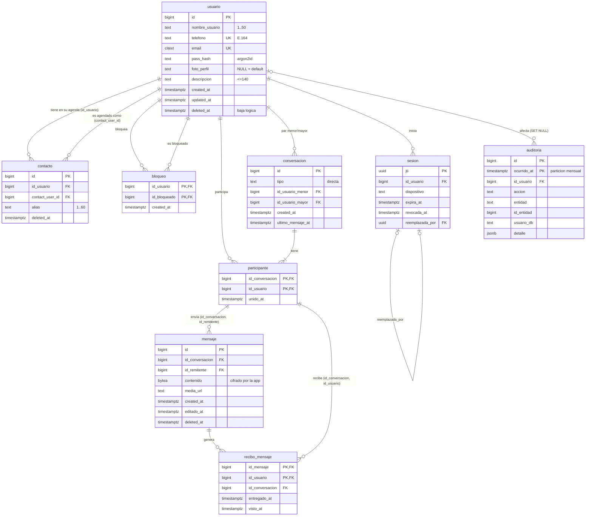

# Modelo de datos de CR_Chat (PostgreSQL 17)

Fuente: `Postgres/migraciones/002_esquema.sql`. Contrato de funciones: [`docs/contratos/db-funciones.md`](../contratos/db-funciones.md).

## Qué cambió respecto al esquema anterior y por qué

| Problema anterior | Solución |
|---|---|
| **Dos filas de `chat` por conversación** (una por sentido). Al enviar un mensaje se buscaba o creaba el "chat inverso" y el mensaje apuntaba a ambos. | `conversacion` tiene una fila por conversación y `participante` es la relación N:M. El mensaje apunta a una sola conversación. |
| **Conversaciones duplicadas posibles.** | `UNIQUE (id_usuario_menor, id_usuario_mayor)` con `CHECK (menor < mayor)`: el par queda en forma canónica. `fn_crear_conversacion` hace `INSERT … ON CONFLICT DO NOTHING`, así que funciona como obtener-o-crear y aguanta carreras. |
| **`contact` unido a `usr` por texto** (`contact_number`) sin FK. Si alguien cambiaba de teléfono, sus contactos quedaban huérfanos. | `contacto.contact_user_id` es una FK a `usuario`. El teléfono vive solo en `usuario` (3FN: el teléfono depende del usuario, no del contacto). |
| **Contactos duplicados.** | `UNIQUE (id_usuario, contact_user_id)` y `CHECK (id_usuario <> contact_user_id)`. |
| **El contacto era obligatorio para chatear.** Al recibir un mensaje se creaba un contacto "Unknown". | La conversación no depende del contacto. El listado hace `LEFT JOIN contacto` y, si el otro usuario no está en mi agenda, `alias` es NULL. |
| **`delivered` / `seen` como booleanos en el mensaje.** | `recibo_mensaje` guarda una fila por destinatario con marcas de tiempo. Escala a grupos y deja saber *cuándo* se entregó o vio el mensaje. |
| **Contraseña y email cifrados de forma reversible con `pgp_sym_encrypt`.** La clave viajaba en cada llamada, `UNIQUE(email)` era inútil (el cifrado no es determinista) y cada login hacía un full scan descifrando filas. | `pass_hash` usa argon2id y se verifica en PHP. `email` es `citext UNIQUE` en claro: la unicidad es real, no distingue mayúsculas y usa índice. El email no es un secreto. Para protegerlo en reposo se usa el cifrado del volumen o disco y el control de acceso (`app_ro` no ve `pass_hash`). |
| **Columnas cifradas demasiado pequeñas** (`VARCHAR(255)`). | El contenido del mensaje es `bytea` de hasta 64 KiB (nonce + ciphertext + tag) y llega ya cifrado desde la app. |
| **Refresh token único por usuario** (`usr.tkR`). | Tabla `sesion` con una fila por dispositivo, `jti`, expiración, revocación y una cadena de rotación (`reemplazada_por`) para detectar reutilización. |
| **Logs con `ON DELETE CASCADE`.** Borrar un usuario borraba su rastro. | `auditoria` usa `ON DELETE SET NULL`, está particionada por mes (RANGE en `ocurrido_at`) y tiene una partición `DEFAULT` como red de seguridad. |
| **Sin índices en FK en PG.** | Toda FK tiene un índice que la cubre (lo verifica `Postgres/pruebas/catalogo.sql`), además de índices para cada consulta de las funciones. |
| **`deleted BOOLEAN`.** | `deleted_at timestamptz`: guarda cuándo se borró y permite índices parciales `WHERE deleted_at IS NULL`. |

## Normalización

- **1FN:** todos los atributos son atómicos. No hay listas en columnas ni el par "chat de ida y chat de vuelta".
- **2FN:** en las tablas con PK compuesta (`participante`, `bloqueo`, `recibo_mensaje`), los atributos no clave
  (`unido_at`, `created_at`, `entregado_at`/`visto_at`) dependen de la clave completa.
- **3FN:** no hay dependencias transitivas sobre la clave. El teléfono, el nombre y la foto del contacto se leen de
  `usuario` y no se copian a `contacto`. `alias` sí es un atributo del contacto: cada usuario nombra a sus contactos como quiere.

### Redundancias deliberadas (controladas)

Hay tres columnas que se pueden derivar de otras. Las tres se mantienen a propósito, y en cada caso la BD **impide que diverjan**:

1. **`conversacion.id_usuario_menor / id_usuario_mayor`** se pueden derivar de `participante`. Son la clave natural que
   permite `UNIQUE` sobre el par: sin ellas no se pueden impedir conversaciones duplicadas con un constraint. Solo
   `fn_crear_conversacion` las escribe, en la misma sentencia que inserta los dos participantes. Para pasar a grupos, se
   relaja `conversacion_tipo_ck` y estas columnas se vuelven NULL en `tipo = 'grupo'`, sin tocar `mensaje` ni `recibo_mensaje`.
2. **`recibo_mensaje.id_conversacion`** se puede derivar de `mensaje`. Está amarrada por dos FK compuestas:
   `(id_mensaje, id_conversacion) → mensaje(id, id_conversacion)` y
   `(id_conversacion, id_usuario) → participante`. No puede apuntar a otra conversación y, además,
   garantiza que **el destinatario es participante**. Sirve para que contar no leídos y marcar entregado/visto
   cuesten O(no leídos) en vez de O(mensajes de la conversación): con 200 000 mensajes, el listado de conversaciones bajó de 342 ms
   a 8 ms (ver `optimizacion.md`).
3. **`conversacion.ultimo_mensaje_at`** se puede derivar de `max(mensaje.created_at)`. Permite ordenar el listado sin
   agregar sobre todos los mensajes. Se actualiza en `fn_enviar_mensaje`.

## Integridad referencial y `ON DELETE`

| FK | Acción | Motivo |
|---|---|---|
| `contacto.*`, `bloqueo.*`, `sesion.id_usuario`, `participante.*`, `conversacion.id_usuario_*` → `usuario` | CASCADE | El borrado **físico** de un usuario es una operación administrativa (derecho al olvido). Lo normal es la baja lógica con `deleted_at`. |
| `mensaje (id_conversacion, id_remitente)` → `participante` | CASCADE | El remitente debe ser participante. Si se borra la participación, sus mensajes se van con ella. |
| `recibo_mensaje` → `mensaje` y → `participante` | CASCADE | Un recibo no existe sin su mensaje y su destinatario. |
| `sesion.reemplazada_por` → `sesion` | SET NULL | La cadena de rotación no impide purgar sesiones viejas. |
| `auditoria.id_usuario` → `usuario` | **SET NULL** | La auditoría **no** se borra en cascada. |

## Índices

| Índice | Para qué sirve |
|---|---|
| `usuario_telefono_uq`, `usuario_email_uq` (citext) | Unicidad y login (`fn_credenciales_login`, una rama por índice). |
| `contacto_par_uq (id_usuario, contact_user_id)` | Unicidad, FK `id_usuario` y el alias en el listado de conversaciones. |
| `contacto_listado_ix (id_usuario, alias, id) WHERE deleted_at IS NULL` | Paginación keyset de contactos. |
| `contacto_alias_trgm_ix` GIN trigram (parcial) | `ILIKE '%q%'` sobre alias en usuarios con agendas grandes. |
| `contacto_contact_user_id_ix`, `bloqueo_id_bloqueado_ix`, `conversacion_id_usuario_mayor_ix`, `sesion_id_usuario_ix`, `sesion_reemplazada_por_ix` | Cubrir FK (borrados en cascada sin seq scan). |
| `mensaje_id_remitente_ix` | Consultas y borrados por remitente (purga de usuario). |
| `participante_id_usuario_ix (id_usuario, id_conversacion)` | FK y "mis conversaciones". |
| `mensaje_cursor_ix (id_conversacion, created_at DESC, id DESC) WHERE deleted_at IS NULL` | Paginación de mensajes (index scan + LIMIT, sin sort). |
| `mensaje_conv_remitente_ix`, `mensaje_id_conv_uq` | FK compuesta hacia participante y destino de la FK de recibos. |
| `recibo_participante_ix (id_usuario, id_conversacion, id_mensaje)` | FK hacia participante y `fn_marcar_entregado`. |
| `recibo_no_visto_ix (…) WHERE visto_at IS NULL` | Contador de no leídos y `fn_marcar_visto`. |
| `sesion_activa_ix (id_usuario) WHERE revocada_at IS NULL` | Revocar todas las sesiones activas. |
| `auditoria_id_usuario_ix`, `auditoria_entidad_ix` (particionados) | Consultas de auditoría por usuario o entidad. |
